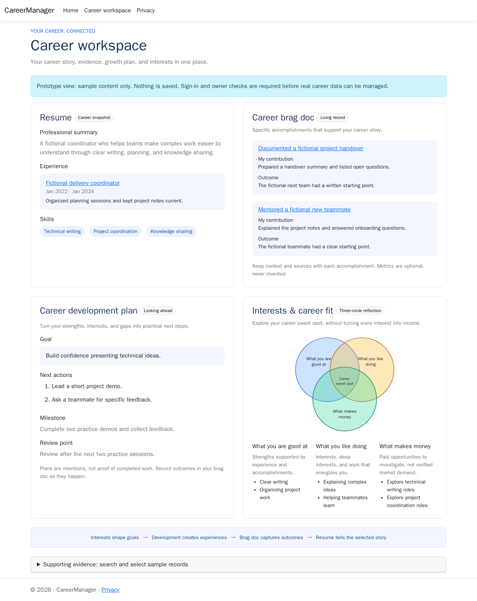
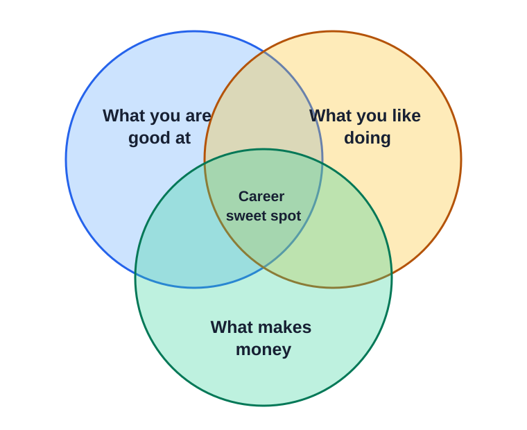

# CareerManager

CareerManager is a private, career-focused workspace for understanding your experience, strengths, interests, and direction. It helps you build a reusable record of your career, explore where you want to go next, and manage opportunities. Role-specific resumes and cover letters are outputs of that broader career work—not the center of the product.

**Status:** The .NET 10 MVC, Azure SQL, and CI foundation (1.1), career evidence workspace (1.3), opportunity management (1.4), and consent-gated role comparisons and draft generation (1.5) are implemented. Microsoft sign-in and identity mapping (1.2) are still in progress. The career workspace prototype uses synthetic content; private career and opportunity data requires an authenticated, owner-mapped account. Document approval/export, career planning, full-data export/deletion, and Azure deployment remain open MVP work.

### Career workspace prototype

Visit `/Home/Workspace` to preview four connected areas:

- **Resume preview:** one possible role-specific output from your broader career evidence.
- **Career brag doc:** concrete accomplishments with personal contributions and outcomes; supporting records retain context, optional metrics, tags, and source notes/URLs.
- **Career development plan:** goals, next actions, milestones, and review points. Plans are intentions, not completed achievements.
- **Interests & career fit:** reflections on what you are good at, what you like doing, and what makes money, using the three-circle model below. Paid-role examples are ideas to investigate, not verified market demand.

The expandable supporting-evidence browser retains search, category filters, and explicit selection for the synthetic prototype. For example: `/Home/Workspace?search=project&category=Work%20experience&selectedIds=1`. Prototype selections are carried only in the page URL and remain separate from private data. Owner-scoped role comparison and evidence-based draft generation are available from an opportunity; the prototype itself does not read or save career data.



## Why this exists

A resume is a narrow, role-specific summary—not a complete career record. Side projects, deep interests, recurring obsessions, lessons learned, and achievements all provide useful evidence of fit. CareerManager makes that information reusable without losing the specifics that make it credible.

The goal is to make relevant experience easier for recruiters and hiring managers to recognize, not to promise interviews or manipulate screening systems.

### Finding your career sweet spot



CareerManager helps you explore the overlap between your strengths, the work you enjoy, and opportunities that pay. That overlap can guide which roles to pursue, which evidence to highlight, and where to focus your career development.

#### A career-focused lens inspired by ikigai

**Ikigai** is a Japanese concept referring to what makes life feel worth living. It can come from relationships, everyday activities, and interests as well as work; it does not require earning money. The popular four-circle career diagram associated with ikigai is a modern interpretation, not a traditional definition of the concept. It combines what you love, what you are good at, what you can be paid for, and **what the world needs**.

CareerManager deliberately uses only three circles as a practical lens for career exploration: what you are good at provides evidence of fit, what you like doing guides motivation, and what makes money connects those strengths and interests to paid opportunities. This is not a complete model of purpose or a claim that all meaningful interests should become income.

Leaving "what the world needs" out of the diagram does not mean impact is unimportant, or that market demand is the same as social value. Consider contribution, company values, and the problems you want to help solve when evaluating individual roles and building your career plan.

## Core workflow

1. Sign in to your private workspace.
2. Build a reusable career profile with experience, education, skills, strengths, interests, achievements, and side projects.
3. Explore career fit and maintain goals and next steps in a career plan.
4. Add an opportunity, its job description, and relevant company values or context.
5. Compare the role with explicitly selected evidence, identifying supported matches, gaps, and questions.
6. With consent, generate and edit draft application documents, such as a tailored resume and cover letter, reviewing the evidence behind factual claims.
7. Review and approve the current documents, export them as PDF or DOCX, and track the opportunity and next actions.

## MVP scope

### Career knowledge base

- Capture work experience, education, skills, strengths, interests/deep interests, achievements, and side projects.
- Record achievements with context, your contribution, outcomes, and optional measurable results.
- Attach evidence references such as project URLs and source notes; tag entries for reuse.
- Search, filter, edit, and remove entries as your career evolves. Missing metrics remain missing; the application does not invent results.

### Roles and applications

- Create, edit, filter, and delete an owner-scoped role record with company, title, job URL, pasted job description, company values/context, source URLs, notes, and important dates.
- Start with manually entered or pasted job descriptions and company context; retain source URLs when available.
- Track roles through saved, preparing, applied, interviewing, offer, rejected, or withdrawn states, including submission date and next-action notes/date.
- Editing a role does not silently rewrite saved document text. When deleting a role with linked documents, the user chooses whether to save (unlink) or delete those documents.

Opportunity and draft endpoints require authentication and a pre-existing owner record. They return 401 for anonymous requests and 403 when the authenticated principal has no mapped owner record. Before generation, the owner previews the role context and explicitly selected evidence, then consents to processing by the configured provider. Remote mode identifies its provider, deployment, and region in the preview; it remains disabled until data-handling terms are approved. Generated comparisons, resumes, and cover letters are editable drafts with evidence references; they are never automatically approved. Editing a role does not silently rewrite saved document text. Deleting an opportunity prompts whether to unlink or delete linked documents. Approval and export UI remain in issue 1.6.

### Tailored documents and career planning

- Compare a role's requirements and company context with only the career evidence explicitly selected by the owner.
- With explicit consent, generate editable drafts such as role comparisons, resumes, and cover letters. Generated content starts as a draft and is never automatically approved.
- Tie factual claims to selected evidence and surface missing references, evidence gaps, and questions. Do not invent qualifications, dates, employers, responsibilities, or results.
- Validate provider output and handle failures explicitly without overwriting existing saved content. Use deterministic provider substitutes in automated tests; CI does not require paid model calls or real career data.
- Allow editing and explicit owner approval of current content. Editing or regenerating approved content clears approval and returns it to draft.
- Export current resume and cover-letter content as PDF and DOCX. Exports must match saved content; outdated persisted exports are invalidated when content changes.
- Keep current document text and evidence references in SQL. Removing referenced evidence does not silently rewrite saved text: surface missing references and require factual review.
- When a role with linked documents is deleted, let the user choose whether to save (unlink) or delete those documents. Do not create hidden historical snapshots.
- Maintain an owner-scoped editable career plan covering target roles, strengths, interests, selected factual evidence, inferred gaps, recommendations, next actions, and progress. `/CareerPlans` supports saving and revisiting the current plan; regeneration previews the exact selected inputs, requires consent, then presents suggestions for explicit replacement. Only the current content is retained, and edits or replacement clear approval.
- Track a role's submission date, but do not claim to retain the exact historical document submitted.

### Privacy and security

Career information and application history are private data. Security is a core requirement, not a later enhancement.

- Use Microsoft account sign-in through the Microsoft identity platform for the explicitly approved owner; disable public registration. Microsoft handles MFA and account recovery.
- Enforce server-side ownership checks for every read, write, generation, and export operation.
- Use secure session cookies, HTTPS, and protection against cross-site request forgery.
- Use encryption at rest through the selected Azure services and managed identity where supported; keep secrets out of source control.
- Keep resumes, job descriptions, personal data, access tokens, and AI prompts/responses out of application logs.
- Before generation, show exactly what selected evidence and role/company context will be processed and obtain explicit consent. The default local provider sends nothing externally; the optional remote provider stays disabled until its region, data-handling terms, and provider-side spending limits are reviewed and approved.
- Treat pasted job descriptions, company text, and model output as untrusted input; never let them override application rules or access other users' data.
- Implement owner-authorized full-data export and "Delete all my data," including stored exports, with a minimal content-free audit trail. Explain service-backup and provider-copy retention/deletion limitations.

## Technology and hosting

The implemented foundation is one ASP.NET Core MVC application targeting .NET 10, Entity Framework Core with the SQL Server provider, and Azure SQL Database. The database includes owner-scoped career evidence and opportunities, plus saved documents with an optional owner-validated opportunity relationship. The MVP remains one deployable application hosted in Azure App Service.

| Area | Confirmed approach and status |
| --- | --- |
| Application | Server-rendered ASP.NET Core MVC on .NET 10; foundation implemented |
| Authentication | Microsoft identity platform with personal Microsoft accounts; approved-owner sign-in and owner mapping remain open in 1.2 |
| Structured data | EF Core and Azure SQL Database |
| Binary exports | Private Azure Blob Storage; PDF and DOCX exports are in issue 1.6 |
| Application generation | Local deterministic `keyword-overlap-v1` provider by default; optional Azure OpenAI `gpt-4o-mini` deployment in East US 2 (Virginia) is disabled until data-handling approval and secure configuration. See [generation defaults](docs/application-generation.md). |
| Production access | App Service managed identity for Azure SQL and Blob Storage |
| Delivery | GitHub Actions CI is implemented; repeatable Azure provisioning and deployment remain open in 1.9 |

Use the smallest viable low-cost service tiers. Do not add microservices, a separate API, Redis, or dedicated search infrastructure for the MVP.

## Issue status

The linked issues are the source of truth for implementation details and acceptance criteria. The current roadmap is:

| Issue | Scope | Status |
| --- | --- | --- |
| [#7 — 1.1 Foundation](https://github.com/samsmithnz/CareerManager/issues/7) | .NET 10 MVC, Azure SQL, migrations, and CI | Closed |
| [#8 — 1.2 Authentication](https://github.com/samsmithnz/CareerManager/issues/8) | Private Microsoft sign-in and owner enforcement | Open |
| [#9 — 1.3 Career evidence](https://github.com/samsmithnz/CareerManager/issues/9) | Career evidence workspace and owner-scoped CRUD | Closed |
| [#10 — 1.4 Opportunities](https://github.com/samsmithnz/CareerManager/issues/10) | Opportunity management and application progress | Closed |
| [#11 — 1.5 Comparisons and drafts](https://github.com/samsmithnz/CareerManager/issues/11) | Evidence-based comparisons and draft generation | Open |
| [#12 — 1.6 Review and export](https://github.com/samsmithnz/CareerManager/issues/12) | Current-document editing, approval, PDF/DOCX export | Open |
| [#13 — 1.7 Career planning](https://github.com/samsmithnz/CareerManager/issues/13) | Editable career plan and explicit approval | Open |
| [#14 — 1.8 Data lifecycle](https://github.com/samsmithnz/CareerManager/issues/14) | Full-data export and delete-all-data | Open |
| [#15 — 1.9 Deployment](https://github.com/samsmithnz/CareerManager/issues/15) | Private Azure deployment and end-to-end verification | Open |
| [#4 — Phase 2](https://github.com/samsmithnz/CareerManager/issues/4) | Document snapshots, version history, and backup/recovery | Open; deferred |

## Quality bar

- No fabricated experience or unsupported factual claims in approved documents.
- Clear errors and recoverable generation failures; failed requests must not overwrite saved documents.
- Private data cannot be accessed without authentication or by another account.
- Readable, keyboard-accessible forms and document previews.
- Automated coverage for ownership boundaries, career evidence, role tracking, validation, and generation failure cases using synthetic data.
- Approval always applies to the current content; saving or exporting does not imply approval.
- Deployment and deletion limitations are documented. Application-managed version history and backup/recovery are Phase 2, not MVP requirements.

## Not in the first MVP

- Automated job scraping, bulk applications, or submitting applications on your behalf.
- Email/calendar integrations, recruiter portals, or public profile sharing.
- Complex resume design tools, multiple visual themes, or guarantees about screening-system rankings.
- Automatic ingestion of every existing document or external profile.
- A commercial multi-tenant service, billing, or collaboration.

## Remaining setup and deferred decisions

- Complete Microsoft identity app registration, redirect URLs, secure credentials, and approved-owner configuration for issue 1.2.
- Before enabling remote generation, confirm the Azure OpenAI deployment is available in East US 2 (Virginia), review its current data-handling terms, retention/training behavior, and configure provider-side spending limits. Real career data must not be sent until the owner approves those terms and explicitly consents to each request.
- Configure Azure resources and GitHub Actions deployment access for issue 1.9. Use managed identity or federated credentials where supported.
- Agree on snapshot/history retention and recovery targets only when implementing Phase 2 issue 4. Azure service-managed protections remain separate from application-level recovery features.

The MVP is private and single-owner. Supporting multiple users would require an explicit scope change, not just enabling registration.

## Development and deployment

### Prerequisites and environment boundaries

- Install the .NET SDK pinned in [`global.json`](global.json) (10.0.401).
- Provision or obtain authorization to a **separate synthetic-data Azure SQL development database** and allow the development machine to connect through the Azure SQL firewall. `CareerManager-Dev` or `CareerManager-Development` is the documented database name.
- Configure Azure SQL connections with encryption and server-certificate validation enabled (`Encrypt=True;TrustServerCertificate=False`).
- Store the development connection string in .NET User Secrets; do not put it in `appsettings*.json`, source control, or logs:

  ```sh
  dotnet user-secrets set "ConnectionStrings:CareerManager" "<authorized Azure SQL connection string>" --project src/CareerManager.Web/CareerManager.Web.csproj
  ```

- Use a different, isolated Azure SQL database named `CareerManager-Test` or `CareerManager-Testing` for database-dependent tests. The test command accepts its connection string only through `CAREERMANAGER_TEST_SQL_CONNECTION`; the integration workflow reads the repository secret `AZURE_SQL_TEST_CONNECTION_STRING`.
- Production configuration is separate: deploy with `ASPNETCORE_ENVIRONMENT=Production` and provide `ConnectionStrings__CareerManager` through the App Service configuration or an approved secret store. Do not reuse development or test credentials or databases. Provisioning and deployment are part of issue 1.9.
- For development/test cost, use the Azure SQL Database free offer when eligible; otherwise choose the lowest currently supported General Purpose serverless compute with auto-pause and the smallest suitable storage. Confirm subscription, region, offer limits, and current pricing in the [Azure SQL free offer](https://learn.microsoft.com/azure/azure-sql/database/free-offer?view=azuresql) and [serverless tier documentation](https://learn.microsoft.com/azure/azure-sql/database/serverless-tier-overview?view=azuresql) before provisioning. No Azure resources or credentials are included here.
- The application fails clearly at startup when `ConnectionStrings:CareerManager` is missing. It does not automatically apply migrations or seed data.

### Restore, build, and run

From the repository root:

```sh
dotnet restore CareerManager.sln
dotnet tool restore
dotnet build CareerManager.sln --configuration Release --no-restore
dotnet test tests/CareerManager.Tests/CareerManager.Tests.csproj --configuration Release
dotnet run --project src/CareerManager.Web
```

The unit tests do not require Azure credentials or a live database. `dotnet run` uses the Development environment from the launch profile and reads the connection string from User Secrets.

### Migrations and synthetic development data

Set `ASPNETCORE_ENVIRONMENT=Development` when running EF commands so the design-time factory can read Development User Secrets. Apply the initial migration only to the authorized development database:

```sh
dotnet ef database update --project src/CareerManager.Web/CareerManager.Web.csproj --startup-project src/CareerManager.Web/CareerManager.Web.csproj
```

Synthetic data is opt-in, repeatable, and guarded to the Development environment and a database named `CareerManager-Dev` or `CareerManager-Development`. It is never applied during application startup:

```sh
CAREERMANAGER_ENABLE_SYNTHETIC_SEED=true dotnet run --project src/CareerManager.Web -- --seed-synthetic
```

Use `dotnet ef migrations add <MigrationName> --project src/CareerManager.Web/CareerManager.Web.csproj --startup-project src/CareerManager.Web/CareerManager.Web.csproj` to add future migrations.

### Azure SQL integration tests and CI

The integration-test project is intentionally separate from the solution so the normal solution test command remains database-free. Run the database-dependent test explicitly against the isolated `CareerManager-Test` database:

```sh
CAREERMANAGER_TEST_SQL_CONNECTION="<authorized test database connection string>" \
  dotnet test tests/CareerManager.IntegrationTests/CareerManager.IntegrationTests.csproj --configuration Release
```

Source `CAREERMANAGER_TEST_SQL_CONNECTION` from an approved local secret facility; do not put its value in source control or shell history. The integration test fails with a setup message if the connection is missing and rejects database names that are not clearly marked as test. It applies migrations, uses a unique test owner, and deletes that owner's data in a `finally` block. Schema migration history remains in the isolated test database.

The standard GitHub Actions CI restores, builds, audits dependencies, and runs only database-free unit tests; it needs no Azure credentials. To run SQL tests in GitHub Actions, configure the `AZURE_SQL_TEST_CONNECTION_STRING` repository secret for the isolated test database and dispatch the **Azure SQL integration tests** workflow. The workflow fails explicitly when that secret is absent. NuGet audit warnings fail the build, pull requests also run dependency review, and Dependabot checks NuGet and GitHub Actions updates.

No local database, SQLite substitute, or database container is used. The public landing/privacy pages and synthetic career-workspace prototype do not expose private career data. Career and opportunity endpoints fail closed until the identity integration maps an authenticated configured owner to `career_owner_id` and that owner exists in the database. Do not configure production access until issue 1.2's Microsoft identity setup and owner mapping are complete.

Before Azure deployment, the owner will need to provision or authorize an Azure subscription/resource group, an identity application, the selected AI service if used, and GitHub Actions deployment access. Use managed identity or federated credentials where supported rather than long-lived deployment secrets.

Do not commit real resumes, personal career records, production database copies, or credentials. Use synthetic data in development and tests.

## Planning

The [1.0 MVP epic](https://github.com/samsmithnz/CareerManager/issues/1) tracks the product scope, implementation sequence, and acceptance criteria. [Issue 4](https://github.com/samsmithnz/CareerManager/issues/4) tracks document history and backup/recovery capabilities deferred to Phase 2.
